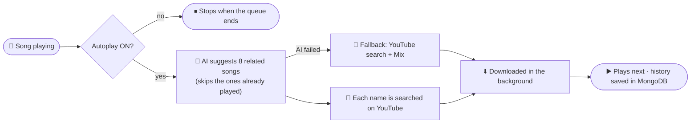

<div align="center">


<br>

[](https://github.com/RishuBot/RishuMusic/stargazers)
[](https://github.com/RishuBot/RishuMusic/network/members)
[](https://github.com/RishuBot/RishuMusic/watchers)
[](https://github.com/RishuBot/RishuMusic/issues)

[](https://github.com/RishuBot/RishuMusic/commits/main)
[](https://github.com/RishuBot/RishuMusic)
[](https://github.com/RishuBot/RishuMusic/graphs/contributors)


**[✨ Features](#-features) · [🖼️ Preview](#️-preview) · [🧠 AI Autoplay](#-ai-autoplay) · [🚀 Deploy](#-deploy) · [⚙️ Configuration](#️-configuration) · [🎮 Commands](#-commands) · [🛠️ Help](#️-troubleshooting)**

<br>

[](https://github.com/RishuBot/RishuMusic)
[](https://github.com/RishuBot/RishuMusic/fork)
[](https://github.com/RishuBot/RishuMusic/issues/new)
[](https://t.me/RishuCoder)

<br>

[](https://heroku.com/deploy?template=https://github.com/RishuBot/RishuMusic)

</div>

---

## ✨ Features

<table>
<tr>
<td width="50%" valign="top">

### 🎧 Playback
- Audio **and video** in group voice chats
- Sources: YouTube, Spotify, Apple Music, Resso, SoundCloud, direct links, Telegram files
- Play **with or without the slash**: `/play kesariya` or just `play kesariya`
- Queue, loop, shuffle, seek, speed, channel play
- Up to **5 assistant accounts**

</td>
<td width="50%" valign="top">

### 🎨 Rich interface
- 🔎 **Searching** card with a live table
- 🎶 **Now Streaming** card with a big *Track Info* heading and a table: Title, Duration, Requested By, **Mode (Audio / Video)**
- ➕ **Added to Queue** card when a song is already playing
- Coloured buttons, premium emojis, and automatic plain-text fallback

</td>
</tr>
<tr>
<td width="50%" valign="top">

### 🤖 Smart extras
- ⬇️ **Audio / Video buttons**: the file is sent to the user's DM
- **AI autoplay** that suggests related songs by name (Gemini or Groq, both free)
- 🔘 **Autoplay ON/OFF** button on the player, or `/autoplay on|off`
- Remembers played songs in MongoDB, so no repeats, even after a restart

</td>
<td width="50%" valign="top">

### 🛡️ Built to stay fast
- Thumbnails render in a worker thread, so the bot never freezes
- Hard time limits and fallbacks on uploads and AI calls
- The owner gets a DM when a step is slow or the AI is not working
- Broadcast, global ban, blacklist, maintenance mode, stats, speedtest

</td>
</tr>
</table>

---

## 🖼️ Preview

What the bot sends in your group:

```text
🔎 Searching                        ➕ Added to Queue
 🎵 Query         kesariya           🔗 Title         Tum Hi Ho
 👤 Requested By  Rishu              ⏱ Duration      4:22 min
 🎧 Mode          Audio              👤 Requested By  Rishu
 ⏳ Status        Searching...       📋 Position      #2 in queue
                                     🎧 Mode          Audio

🎵 Track Info
 🔗 Title         Kesariya
 ⏱ Duration      4:28 min            [ ▷ ] [ Autoplay: ON ] [ II ]
 👤 Requested By  Rishu               [ ↻ ] [ ▶▶| ]          [ □ ]
 🎧 Mode          Audio               [ 🎵 Audio ]       [ 🎬 Video ]
```

> The buttons are coloured (blue, green, red) and the Audio / Video buttons send the track straight to your DM.

---

## 🧠 AI Autoplay

When the queue is about to end, the AI picks what plays next. It only suggests song **names**, so a failing AI can never stop the music.



- **Providers:** Gemini first, then Groq. Retired models are skipped and current ones are found automatically.
- **No repeats:** the last 300 songs of every chat are stored in MongoDB.
- **Visible:** the owner gets `🤖 AI autoplay works` once, or `⚠️ AI autoplay gave no songs` with the reason.

---

## 🚀 Deploy

### Requirements

| What | Notes |
|---|---|
| Python | 3.10+ (Docker image: 3.10, Heroku runtime: 3.11) |
| FFmpeg · Node.js 20 | Needed for streaming (both are in the Docker image) |
| MongoDB | A free [Atlas](https://cloud.mongodb.com) cluster is enough |
| `API_ID`, `API_HASH` | From [my.telegram.org](https://my.telegram.org) |
| Bot token | From [@BotFather](https://t.me/BotFather) |
| Assistant session | A Pyrogram v2 **string session** of a normal user account |

> ⚠️ Rich cards need **Kurigram ≥ 2.2.26**. `pyrofork` installs a package with the same `pyrogram` name and can replace Kurigram, so **do not install both**.

### 1️⃣ Heroku, one click
Press the **Deploy to Heroku** button at the top, fill in the variables, deploy.

### 2️⃣ Railway · Render · Koyeb · VPS (Docker)
```bash
git clone https://github.com/RishuBot/RishuMusic
cd RishuMusic
cp sample.env .env        # fill in your values
docker build -t rishumusic .
docker run --env-file .env rishumusic
```
On Railway, Render and Koyeb, create a **worker** service from your fork (it uses the `Dockerfile`) and add the variables in the dashboard.

### 3️⃣ Run locally
```bash
pip install -U -r requirements.txt
cp sample.env .env
bash start
```

Then add the bot to your group, make it **admin**, start a voice chat and send `play <song name>`.

---

## ⚙️ Configuration

Everything is an environment variable, read in `config.py`. Never put real values in the code.

<details open>
<summary><b>Required</b></summary>

| Variable | Description |
|---|---|
| `API_ID`, `API_HASH` | Telegram API credentials |
| `BOT_TOKEN` | Token from BotFather |
| `MONGO_DB_URI` | MongoDB connection string |
| `OWNER_ID` | Your Telegram user id (receives owner alerts) |
| `LOGGER_ID` | Id of a log group, with the bot as admin |
| `STRING_SESSION` | Pyrogram v2 string session of the assistant account |

</details>

<details>
<summary><b>Optional: general</b></summary>

| Variable | Default | Description |
|---|---|---|
| `STRING_SESSION2` … `STRING_SESSION5` | none | More assistant accounts |
| `DURATION_LIMIT` | `300` | Longest allowed track, in minutes |
| `PLAYLIST_FETCH_LIMIT` | `25` | Max songs taken from a playlist |
| `ASSISTANT_LEAVE_TIME` | `5400` | Seconds before an idle assistant leaves a chat |
| `SPOTIFY_CLIENT_ID`, `SPOTIFY_CLIENT_SECRET` | set your own | For Spotify links ([dashboard](https://developer.spotify.com/dashboard)) |
| `SUPPORT_CHANNEL`, `SUPPORT_CHAT` | set your own | Links shown on the start card |
| `HEROKU_APP_NAME`, `HEROKU_API_KEY` | none | Only for `/update` and `/restart` on Heroku |
| `UPSTREAM_BRANCH` | `main` | Branch used by `/update` |

</details>

<details>
<summary><b>Optional: download APIs</b></summary>

| Variable | Default | Description |
|---|---|---|
| `MUSIC_API_URL`, `MUSIC_API_KEY` | built-in URL, set your own key | Music download API used for playback |
| `DL_API_URL` | `https://vapters.site/stream` | API behind the **Audio / Video** buttons |
| `DL_AUDIO_QUALITY` | `192` | Audio bitrate for the button |
| `DL_VIDEO_QUALITY` | `720` | Video quality for the button |

</details>

<details>
<summary><b>Optional: AI autoplay</b> (set at least one key, both are free)</summary>

| Variable | Description |
|---|---|
| `GEMINI_API_KEY` | Free key from [Google AI Studio](https://aistudio.google.com) |
| `GROQ_API_KEY` | Free key from [Groq Console](https://console.groq.com) |
| `GEMINI_MODEL`, `GROQ_MODELS` | Leave **empty** for automatic model choice |
| `POLLINATIONS_KEY` | Optional third provider (needs a key) |
| `AI_AUTOPLAY` | `0` turns the AI part off completely |

</details>

<details>
<summary><b>Optional: performance</b></summary>

| Variable | Default | Description |
|---|---|---|
| `CARD_UPLOAD` | `1` | `1` uploads the generated thumbnail to a temporary host (max 4 s). `0` always uses the YouTube thumbnail (fastest) |
| `SLOW_REPORT_SECONDS` | `6` | A step slower than this is reported to the owner |

</details>

---

## 🎮 Commands

<details open>
<summary><b>▶️ Play</b></summary>

| Command | Description |
|---|---|
| `/play <name or link>` or `play <name or link>` | Play audio |
| `/vplay` | Play video |
| `/cplay` · `/cvplay` | Play in the linked channel's voice chat |
| `/playforce` · `/vplayforce` · `/cplayforce` · `/cvplayforce` | Skip the queue and play now |
| `/playmode` · `/channelplay` | Choose play mode / channel |
| `/queue` · `/player` | Show the queue / current player |
| `/autoplay on` \| `off` | Turn AI autoplay on or off |

</details>

<details>
<summary><b>⏯️ Player controls (admins)</b></summary>

`/pause` `/resume` `/skip` `/stop` `/end` `/loop` `/shuffle` `/seek` `/seekback` `/speed`
Channel versions start with `c`, for example `/cskip`. Most of them are also buttons under the player card.

</details>

<details>
<summary><b>🧰 Tools</b></summary>

`/start` `/help` `/settings` `/lang` `/ping` `/stats` `/speedtest` `/activevc` `/auth` `/unauth` `/authlist` `/reload`

</details>

<details>
<summary><b>👑 Owner / sudo</b></summary>

`/broadcast` `/gban` `/ungban` `/block` `/unblock` `/blchat` `/addsudo` `/delsudo` `/sudolist` `/maintenance` `/logger` `/autoend` `/restart` `/update` `/getlog`

</details>

---

## 🔔 Messages you may get as the owner

| Message | What it means |
|---|---|
| `🤖 AI autoplay works (provider: …)` | The AI is running and suggesting songs |
| `⚠️ AI autoplay gave no songs` | The AI failed and the text shows why. The old method was used instead |
| `🐢 Slow step: join_call took 14.2s` | One step was slow. The name tells you where to look: `download`, `join_call`, `thumbnail`, `card` |
| `⚠️ stream._rich_photo_card […] failed` | Telegram refused a rich feature and the bot fell back automatically |

---

## 🗂️ Project structure

<details>
<summary><b>Show the folders</b></summary>

```text
RishuMusic/
├── config.py                 # all settings, read from environment variables
├── sample.env                # template for your .env
├── app.json · Dockerfile · Procfile · heroku.yml · start
├── docs/banner.svg
├── strings/                  # language files
└── RishuMusic/
    ├── core/                 # bot, assistants, voice-chat calls, MongoDB
    ├── platforms/            # YouTube, Spotify, Apple, Resso, SoundCloud, Telegram
    ├── plugins/
    │   ├── play/             # play, live, playmode, download buttons
    │   ├── admins/           # pause, skip, loop, seek, speed, callbacks
    │   ├── bot/              # start, help, settings
    │   ├── tools/            # queue, autoplay, ping, stats, language
    │   ├── sudo/             # gban, block, maintenance, restart
    │   └── misc/             # broadcast, auto-leave, watcher
    └── utils/
        ├── stream/           # streaming and the Now Streaming / Queue cards
        ├── autoplay/         # AI + YouTube related songs, history, prefetch
        ├── inline/           # keyboards
        ├── rich_ui.py        # rich message helpers
        ├── play_buttons.py   # button colours and the autoplay toggle
        └── thumbnails.py     # thumbnail rendering
```

</details>

---

## 🛠️ Troubleshooting

| Problem | Fix |
|---|---|
| Cards are plain, no table or colours | Make sure **Kurigram ≥ 2.2.26** is the installed `pyrogram`, and remove `pyrofork` from `requirements.txt` |
| Bot does not join the voice chat | Make the bot **admin**, start a voice chat first, and check that the assistant account is not banned in the group |
| Songs repeat in autoplay | Add `GEMINI_API_KEY` or `GROQ_API_KEY` and watch your DMs for `⚠️ AI autoplay gave no songs` |
| The bot feels slow | Look for `🐢 Slow step` DMs. Try `CARD_UPLOAD=0` and `AI_AUTOPLAY=0` to see what changes |
| Audio / Video button cannot send the file | The user must open the bot in DM and press Start once |

---

## 🔒 Security

- Put **every** secret (bot token, string sessions, MongoDB URI, API keys) in environment variables. Never commit them.
- If a secret was ever committed, treat it as leaked and rotate it: new bot token from BotFather, new database password, new API keys.

---

## ⭐ Support the project

If RishuMusic helps you, a star takes two seconds and keeps the project going.

[](https://star-history.com/#RishuBot/RishuMusic&Date)

### 👥 Contributors

<a href="https://github.com/RishuBot/RishuMusic/graphs/contributors">
  
</a>

---

<div align="center">

Built on the open-source Pyrogram / Kurigram + py-tgcalls music-bot ecosystem. Thanks to the original authors and to everyone who contributes.

**Maintained by Rishu** · Telegram [@RishuCoder](https://t.me/RishuCoder)

⭐ **Star** · 🍴 **Fork** · 🐞 **Report** · 💬 **Say hi**

</div>
